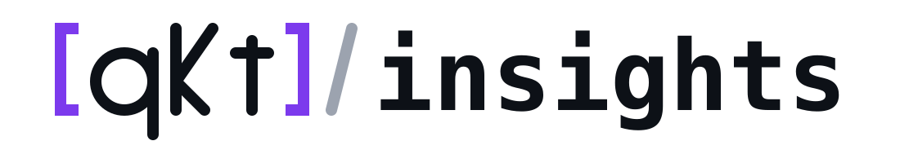
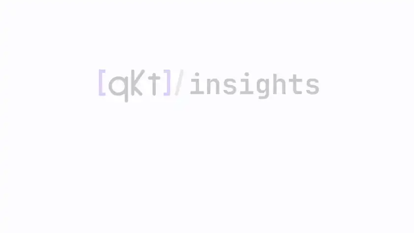

<p align="center">
  <picture>
    <source media="(prefers-color-scheme: dark)" srcset="docs/assets/qkt-insights-logo-dark.svg">
    
  </picture>
</p>

<h3 align="center">See every trade qkt makes.<br/>A self-hosted dashboard and collector, in one container.</h3>

<p align="center">
  <a href="https://github.com/elitekaycy/qkt-insights/actions/workflows/ci.yml"></a>
  <a href="LICENSE"></a>
  <a href="https://github.com/elitekaycy/qkt-insights/pkgs/container/qkt-insights"></a>
</p>

<p align="center">
  <a href="docs/assets/qkt-insights-full-dark.mp4">
    <picture>
      <source media="(prefers-color-scheme: dark)" srcset="docs/assets/qkt-insights-loop-dark.webp">
      
    </picture>
  </a>
</p>

<p align="center"><sub>Every command in this clip was run for real.<br/><a href="docs/assets/qkt-insights-full-dark.mp4">Watch the full walkthrough</a></sub></p>

<br/>

## What it is

qkt-insights receives the events a running [qkt](https://github.com/elitekaycy/qkt) instance already produces
(signals, orders, fills, risk halts, equity, logs), keeps them in SQLite, and serves a React dashboard behind one
admin login. Point any number of qkt instances at one collector and switch between them in the sidebar.

```text
qkt instance(s) ──POST /ingest──▶ qkt-insights (SQLite) ──▶ dashboard in your browser
```

It stays off the trading hot path: qkt ships events from a background thread, and if the collector is slow or
down, events are dropped and the engine keeps trading.

<br/>

## Quick start

**1. Start the collector**

```bash
docker run -d --name qkt-insights \
  -p 127.0.0.1:8420:8420 \
  -v insights-data:/data \
  -e INSIGHTS_DB=/data/insights.db \
  -e INGEST_TOKEN='change-this-to-a-long-random-token' \
  -e ADMIN_USERNAME=admin \
  -e ADMIN_PASSWORD='change-this-password' \
  ghcr.io/elitekaycy/qkt-insights:latest run
```

The token needs at least 24 characters and the password at least 12. Check it is up:

```bash
curl -s --retry 10 --retry-all-errors \
  localhost:8420/healthz
```

**2. Send it a trade**

qkt does this for you once it points here (step 4). Sending one by hand shows what the collector expects:

```bash
export INGEST_TOKEN='change-this-to-a-long-random-token'

T=$(date +%s%3N); curl -s localhost:8420/ingest \
  -H "Authorization: Bearer $INGEST_TOKEN" \
  -H "Content-Type: application/json" -d @- <<EOF
{"instanceId":"demo","events":[{"v":1,"id":"t1","seq":1,
"instanceId":"demo","strategyId":"ema-cross","ts":$T,
"type":"trade","payload":{"orderId":"O-1","side":"BUY",
"symbol":"EURUSD","price":1.0842,"qty":0.1,"ts":$T}}]}
EOF
```

**3. Sign in and read it back**

```bash
curl -s -c jar.txt localhost:8420/auth/login \
  -H "Content-Type: application/json" \
  -d '{"username":"admin","password":"change-this-password"}'

curl -s -b jar.txt \
  "localhost:8420/stats?instance=demo&strategy=ema-cross"
```

You will see `"accepted": 1` from step 2 and `"tradeCount": 1` here. Open <http://localhost:8420>, sign in, and
the `demo` instance is in the sidebar with the trade on its Trades page.

**4. Point qkt at it**

In `qkt.config.yaml` (qkt 0.40.0 or newer), with the same token in `INGEST_TOKEN`:

```yaml
insights:
  enabled: true
  url: "http://localhost:8420/ingest"
  instance_id: "qkt-prod"
  token: "${INGEST_TOKEN}"
  events: [trade, order, signal, risk, position, log]
```

<br/>

## Next

| I want to | Read |
| --- | --- |
| See every page | [Screens](docs/PAGES.md) |
| Change a setting, pick a run mode | [Configuration](docs/CONFIGURATION.md) |
| Reach it from the internet | [Exposing the dashboard](docs/operations/internet-exposure.md) |
| Get alerts when something goes quiet | [Uptime and alerts](docs/operations/uptime-and-alerts.md) |
| Share a read-only view | [Sharing dashboards publicly](docs/operations/public-sharing.md) |
| Measure a strategy against its own capital | [Strategy capital](docs/operations/strategy-capital.md) |
| Back up and restore | [Retention, backup and restore](docs/operations/retention-backup-restore.md) |
| Install it on a phone | [Install on your phone](docs/operations/install-on-phone.md) |
| Understand how it is built | [Features and architecture](docs/ARCHITECTURE.md) |
| Contribute | [CONTRIBUTING.md](CONTRIBUTING.md) |

<br/>

<sub>Apache 2.0 licensed. &copy; Dickson Anyaele. Built for [qkt](https://github.com/elitekaycy/qkt); live MetaTrader 5 trading goes through [mt5-gateway](https://github.com/elitekaycy/mt5-gateway).</sub>
