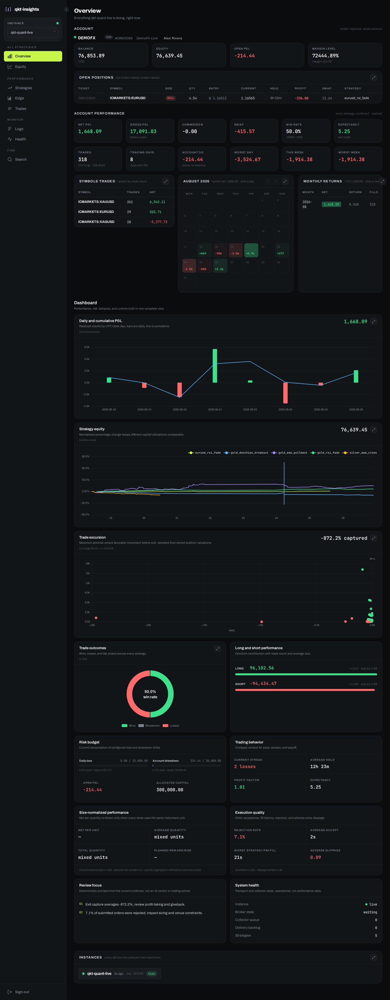

# Screens

A tour of every page in the dashboard. The left rail (a bottom tab bar on phones) holds
Home, Strategies, Trades, Calendar, Equity & risk, Edge, Logs and Health, with Settings at the
bottom. Every page, strategy, tab, instance, date range and filter is in the URL, so links,
Back and reload work; shared links nest their pages under `/p/<token>/`. Dark is the default
theme; a light theme is one click away and remembered per device. All times are UTC. Screenshots are from a live instance; the
account number, broker name, and account holder on **Home** and **Health** are
placeholders — everything else (balance, positions, strategies, trades, logs) is real.

## Home

Am I safe right now, on one screen. Per venue account: balance, equity, **Today** (realized
since the account's trading day began plus floating, the day basis printed), open risk to the
stops in money (positions without a stop are counted and flagged, never summed), and gauges for
daily loss and max drawdown against the account's own limits with their basis. Then the open
positions with SL, TP, money to the stop, floating P&L incl. swap and held time; a sortable
strategy table (status and halt reason, Today, 7D, MTD, all-time, max drawdown, trades, win rate,
last close, plus an unattributed row) whose rows open the strategy; realized P&L by UTC day with
7D/MTD/YTD/All chips held in the URL (`range`); and the month calendar, whose days open their
trades. Shared links show the same page 15 minutes behind, with open positions as a count and
total only. Instrument splits, monthly returns and drawdown periods live on Calendar, Equity &
risk and the strategy pages.

## Equity & risk

Broker account equity over time, per-strategy equity normalized to % change,
underwater curve, and drawdown periods.

## Strategies

Every standalone and portfolio strategy on the instance, with live P&L and return.
A strategy the engine has halted (`risk.halted` with no later `risk.resumed`) carries a
`halted` badge; clicking or tapping it gives the reason, when it tripped and how it clears, and the
strategy page spells it out, with `qkt resume <name>` for a persistent halt.
A session-level halt covers the strategies its session runs (`sessionStrategies`, qkt#1244);
from older engines, which do not name them, it covers every strategy of the instance.
A session start sends each strategy's own halt state (`risk.snapshot`, qkt v0.52.4); that
replaces whatever the earlier halt events implied for the strategy.

## Calendar

The account's P&L calendar: Monday-first weeks with a week column, each day shaded by its
size, today marked in progress, and monthly returns on the account's base. Click a day for the
round trips that closed on it (each opens the trade drawer, and "Open in Trades" lists them with
`exit:<day>`), or a month for its breakdown.

## Edge

When a strategy makes money: day-of-week × hour P&L heatmap, weekday/hour bars with
per-bucket sample size, and rolling edge stability. Buckets under 30 trades render
desaturated — thin slices are noise, and the UI says so.

## Trades

Every round trip on the instance, one row per position from entry to exit, with P&L after
commission, swap and fees, R against the initial stop, hold time and how it ended (stop, target,
the strategy's signal, the venue, or by hand). Unattributed positions are included.

The query bar takes free text and tags, and every tag becomes a removable chip:
`strategy:gold_ema_pullback`, `symbol:XAUUSD` (broker prefixes folded), `side:long|short`, `pnl:>50`,
`pnl:<0`, `r:>=1`, `held:<1h`, `held:1h..4h`, `entry:2026-10`, `exit:2026-10-21`,
`ended:stop|tp|signal|venue|manual`, `size:>=0.5`, `#<ticket>`, and the bare words `win`, `loss` and `open`.
A later tag of the same key replaces the earlier one; a word it cannot read gets a message naming
what it expected, and the rest still apply. Completions come from the instance's own strategies,
instruments and days. `/` focuses the bar, `Esc` clears it, `j`/`k` move through the rows and
`Enter` opens the trade. The query lives in the URL (`?q=`) and follows you to a strategy's Trades
tab, the Calendar and Logs. Headers sort, Export CSV downloads the whole match, and the count line
says how many of how many, with their net and win rate.

A row opens the trade drawer (`?trade=<ticket>`, so it can be linked): the timeline from the rule
and signal through submit, venue accept, fills, stop/target changes and the close, with the time
between steps; slippage against the engine's reference price, stop or target in price and money;
MAE/MFE from the position's marks; the venue's deals; and the raw events as copyable JSON.

## Logs

Engine logs shipped from the instance, searched with the same query bar: `level:error`,
`strategy:`, `logger:MT5Broker`, `time:1h` or `time:2026-10-21`, and free text.

## Health

Fleet at a glance, then uptime: one heartbeat monitor per daemon, one market-data
monitor per daemon when `INSIGHTS_MARKETDATA_MONITOR` is on, and every declared HTTP
probe, each with a 24h strip (30-minute bars, red on any failed check, grey when
nothing was checking), uptime over 24h and 30d, latency or the failure reason, and
how long it has held its current status. Incidents lists every up/down transition.
Below that, runtime status for every reporting instance: last event age, sequence
position, sink delivery counters, journal backlog, and broker account truth.

## Settings

Sharing (public or private per overview, portfolio and strategy, with copy and rotate),
Viewership of shared links, the theme, installing the app, and signing out.

Old `/find` links (the retired Search page) open Logs.
