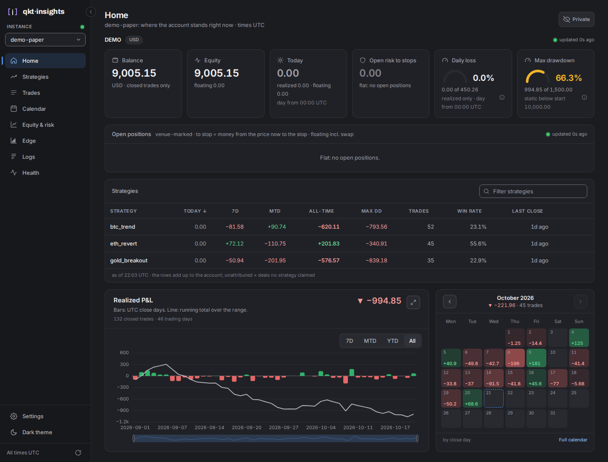
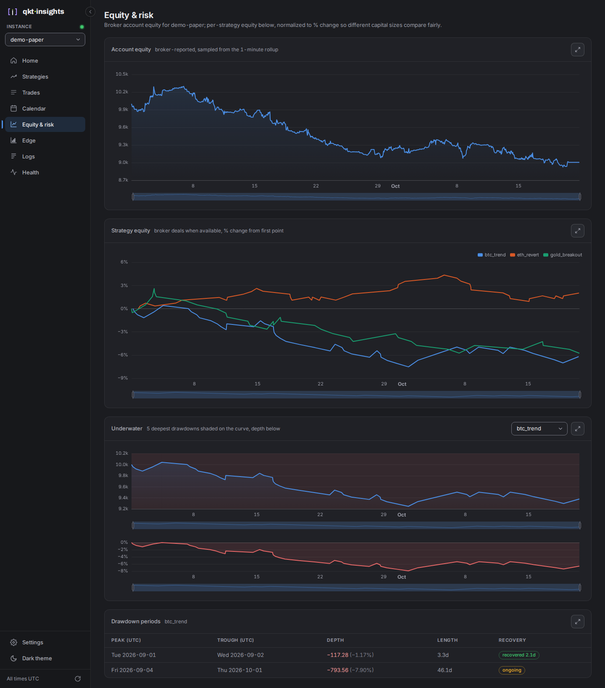
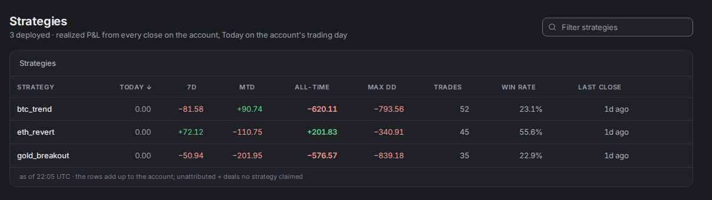
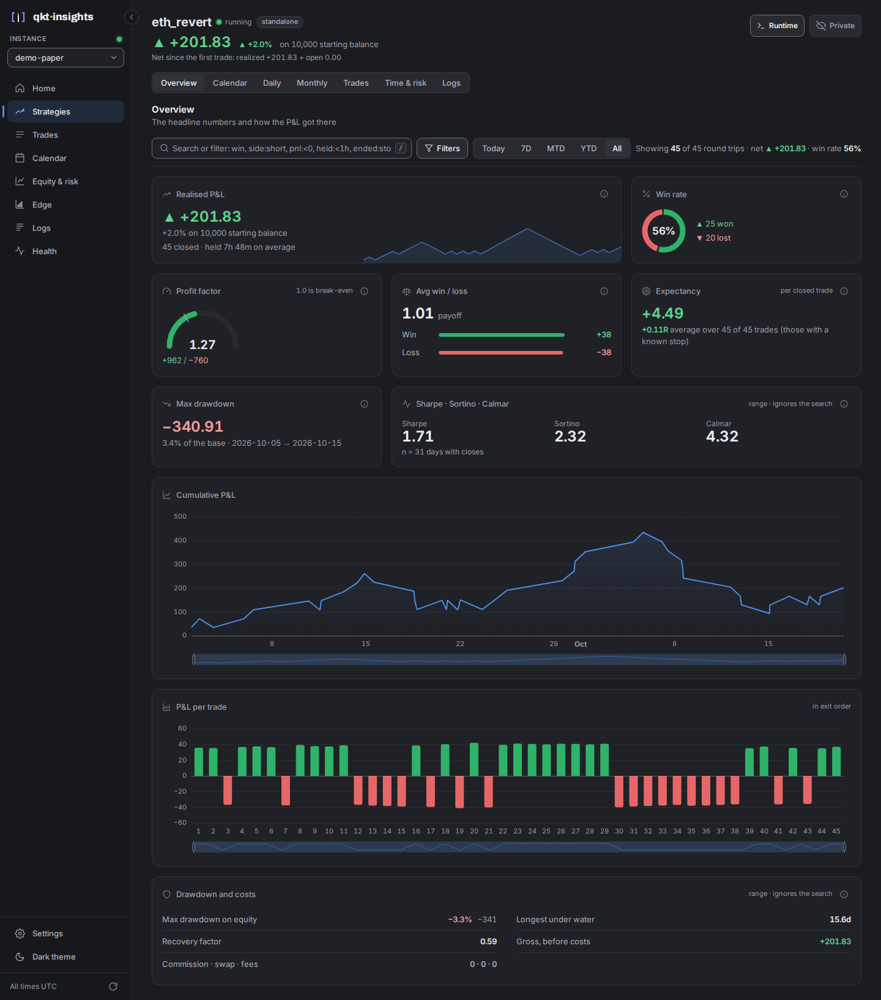
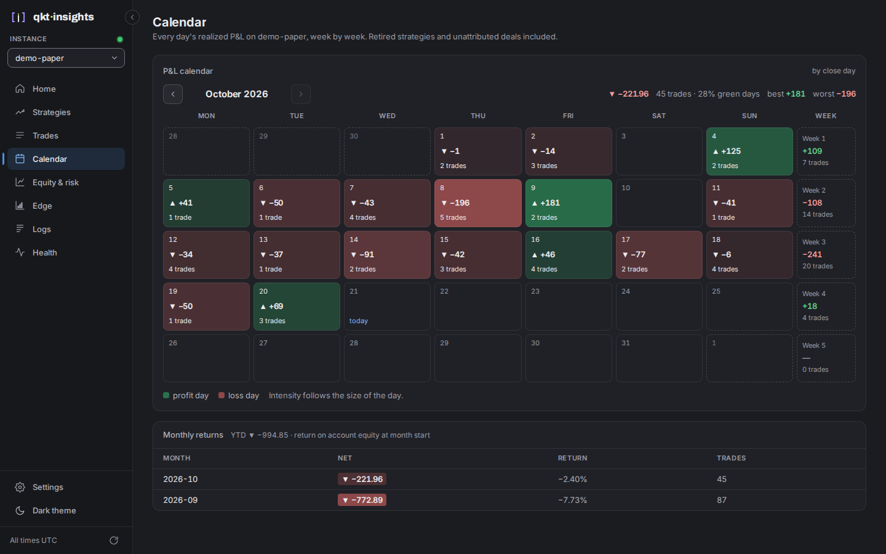
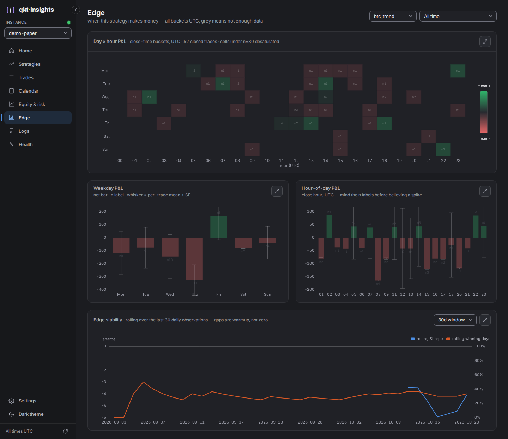
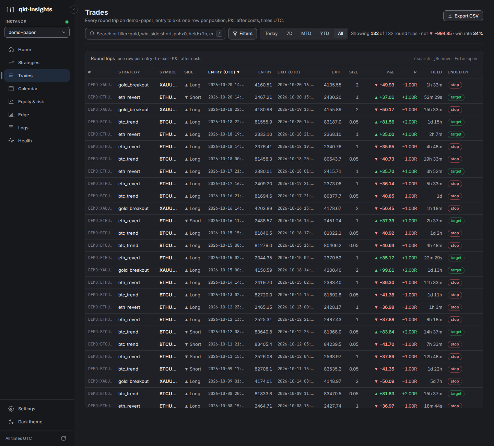
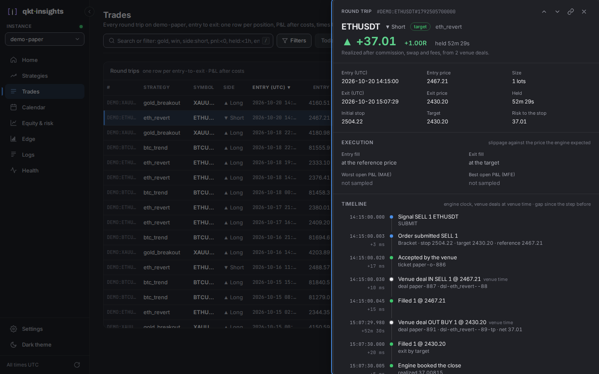
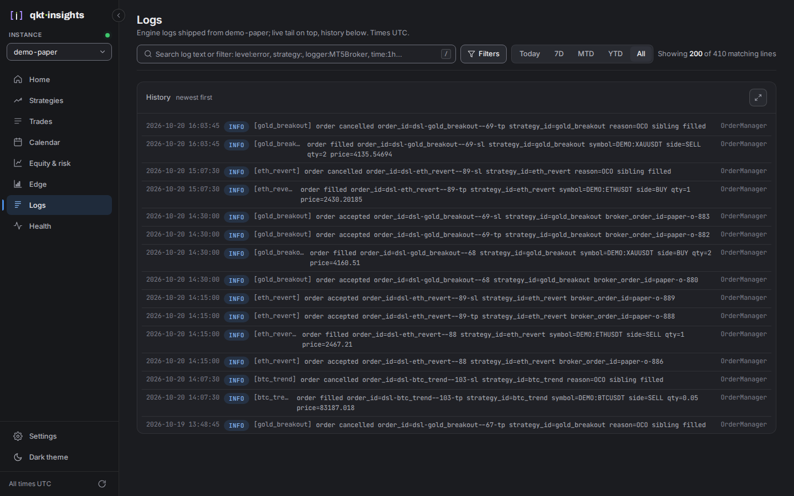
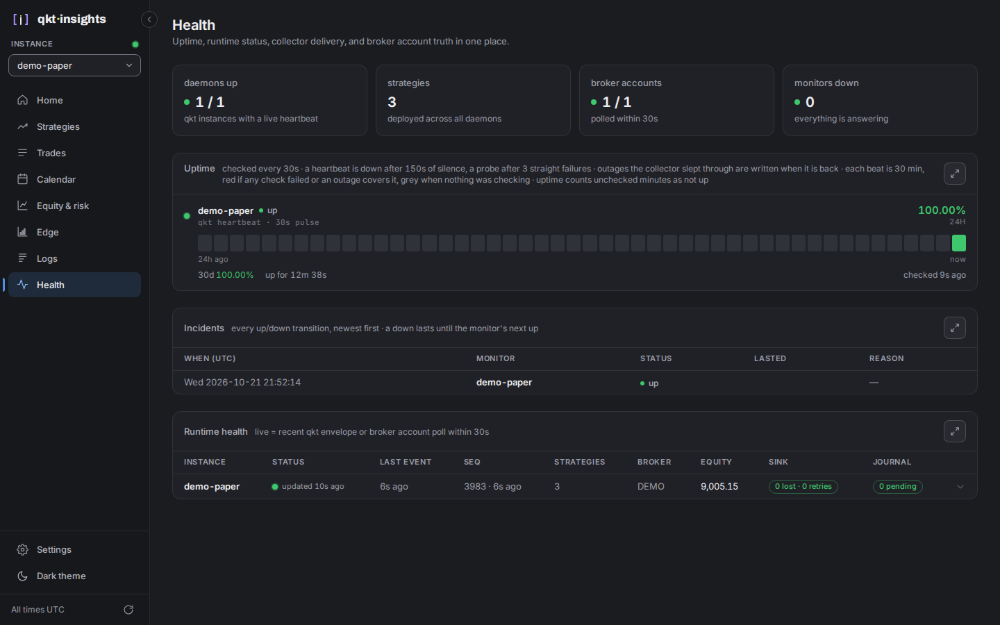

# Screens

A tour of every page in the dashboard. The left rail (a bottom tab bar on phones) holds
Home, Strategies, Trades, Calendar, Equity & risk, Edge, Logs and Health, with Settings at the
bottom. Every page, strategy, tab, instance, date range and filter is in the URL, so links,
Back and reload work; shared links nest their pages under `/p/<token>/`. Dark is the default
theme; a light theme is one click away and remembered per device. All times are UTC. Screenshots are from a demo collector: a paper account named
`DEMO` (10,000 USD) holding three strategies (`btc_trend`, `eth_revert`, `gold_breakout`) whose
seven weeks of qkt 0.61.0 backtests on Binance USD-M 15m bars (1 September to 20 October 2026)
were replayed into it as the envelopes qkt sends. Every trade, price and result is the backtests'
own, losses included; no real account or money is shown. How it was made:
`scripts/export/insights-demo/` in [qkt-site](https://github.com/solol3veling/qkt.platform).

## Home

Am I safe right now, on one screen. Per venue account: balance, equity, **Today** (realized
since the account's trading day began plus floating, the day basis printed), open risk to the
stops in money (positions without a stop are counted and flagged, never summed), and gauges for
daily loss and max drawdown against the account's own limits with their basis. Then the open
positions with SL, TP, money to the stop, floating P&L incl. swap and held time; a sortable
strategy table (status and halt reason, Today, 7D, MTD, all-time, max drawdown, trades, win rate,
last close, plus an unattributed row) whose rows open the strategy; realized P&L by UTC day with
7D/MTD/YTD/All chips held in the URL (`range`); and the month calendar, whose days open their
trades. Shared links show the same page 15 minutes behind, with open positions as a count and
total only. Instrument splits, monthly returns and drawdown periods live on Calendar, Equity &
risk and the strategy pages.

## Equity & risk

Broker account equity over time, per-strategy equity normalized to % change,
underwater curve, and drawdown periods.

## Strategies

Every strategy on the instance as a card, from the same figures as Home's table: net P&L
(realized from every close on the account plus what it floats) with its return on the strategy's
own base, a sparkline of cumulative realized P&L, trades, win rate, max drawdown and last close.
Each portfolio is a group card (net, return on the allocated capital, combined curve) that opens
the portfolio page, with its sleeves as cards beneath; standalone strategies follow in a grid of
three, two or one columns by width. A running strategy carries no badge; a halted one is a muted
card with a quiet "Halted" (the reason on hover or tap). The search box filters the cards, a select
orders them by net, today, name or last trade, and retired and empty strategies are one click
away. The whole card is the link (click, tap or Enter).

A strategy page follows the backtester journal. The header carries the net since the first trade
(realized plus open), the return on the strategy's own base with the base named (portfolio
allocation, `STRATEGY_CAPITAL`, or the starting balance), the status, and a Runtime popover (mode,
DSL version, source, hash, streams). When the engine has halted it (`risk.halted` with no later
`risk.resumed`), a banner at the top says why, since when, how it clears and, for a persistent
halt, `qkt resume <name>`. A session-level halt covers the strategies its session runs
(`sessionStrategies`, qkt#1244); from older engines, which do not name them, it covers every
strategy of the instance. A session start sends each strategy's own halt state (`risk.snapshot`,
qkt v0.52.4); that replaces whatever the earlier halt events implied for the strategy. qkt sends
that snapshot without the halt's time, so "since" is the earliest stored halt with the same
reason; when none survives it reads "before <the first re-assertion>" (`haltedBefore`), never the
restart.

The sections are in the URL (`/s/<id>`, `/s/<id>/calendar`, `daily`, `monthly`, `trades`, `time`,
`code`, `logs`) and all read one scope: the date range chips (Today, 7D, MTD, YTD, All, as `range`) and the
query bar (`q`), with "Showing k of n round trips" and their net and win rate. The unit is the
closed round trip.

- **Overview**: realised P&L with its return, win rate ring, profit factor gauge (break-even at
  1.0), average win and loss with the payoff, expectancy in money and in R when the entries had a
  stop, max drawdown of the running total, Sharpe, Sortino and Calmar once 20 days have closes,
  the cumulative P&L and each trade's P&L (a click opens the trade), and drawdown on equity with
  the cost split. The ratios and costs follow the range but not the search, and say so.
- **Calendar**, **Daily**, **Monthly**: P&L by UTC exit day and month, the week column, the day
  table with the running total, the zoom bar that sums exactly the visible days, the month table
  with return on the base, and the year by month heat. A day or month click narrows the query
  (`exit:<day>`) and lists its trades underneath while the whole period stays on screen.
- **Trades**: the round trips of the query, sortable, with CSV export.
- **Time & risk**: side, how trades ended, hold time, UTC entry weekday and hour (with n; buckets
  under 30 trades are faded), R, streaks and how the next trade went after N losses.
- **Code**: the strategy's source as qkt runs it, highlighted with qkt's own TextMate grammar
  (`apps/web/src/strategy/code/qkt.tmLanguage.json`, a copy of qkt's `editor/textmate/qkt.tmLanguage.json`:
  refresh it by copying that file unchanged), with line numbers, a copy button, the file's path and sha256,
  and when it first ran. Every earlier version qkt reported is listed by its sha and can be opened, and
  "Changes since" shows a line diff against the version before. A version without text says why: qkt sent
  none (a release before qkt reported code), or it sent the text at an earlier start this collector does not
  hold. The section is admin only; shared links never show it.
- **Logs**: the latest lines, and a link to Logs filtered with `strategy:<id>`.

Every bar, bucket, row and ring segment narrows the query to the trades behind it (a second click
clears it), and every card says what clicking does. Explanations open on click or tap.

## Calendar

The account's P&L calendar: Monday-first weeks with a week column, each day shaded by its
size, today marked in progress, and monthly returns on the account's base. Click a day for the
round trips that closed on it (each opens the trade drawer, and "Open in Trades" lists them with
`exit:<day>`), or a month for its breakdown.

## Edge

When a strategy makes money: day-of-week × hour P&L heatmap, weekday/hour bars with
per-bucket sample size, and rolling edge stability. Buckets under 30 trades render
desaturated — thin slices are noise, and the UI says so.

## Trades

Every round trip on the instance, one row per position from entry to exit, with P&L after
commission, swap and fees, R against the initial stop, hold time and how it ended (stop, target,
the strategy's signal, the venue, or by hand). Unattributed positions are included.

The query bar takes free text and tags, and every tag becomes a removable chip:
`strategy:gold_ema_pullback`, `symbol:XAUUSD` (broker prefixes folded), `side:long|short`, `pnl:>50`,
`pnl:<0`, `r:>=1`, `held:<1h`, `held:1h..4h`, `entry:2026-10`, `exit:2026-10-21`,
`ended:stop|tp|signal|venue|manual`, `size:>=0.5`, `weekday:mon` and `hour:14` (UTC entry), `#<ticket>`, and the bare
words `win`, `loss` and `open`.
A later tag of the same key replaces the earlier one; a word it cannot read gets a message naming
what it expected, and the rest still apply. Completions come from the instance's own strategies,
instruments and days. `/` focuses the bar, `Esc` clears it, `j`/`k` move through the rows and
`Enter` opens the trade. The query lives in the URL (`?q=`) and follows you to a strategy's Trades
tab, the Calendar and Logs. Headers sort, Export CSV downloads the whole match, and the count line
says how many of how many, with their net and win rate.

Money is held at the account currency's minor unit (cents for USD): every closing leg and round
trip is stored rounded to it, so `pnl:=-280.35` finds the trade printed as −280.35, a trade that
nets to 0.00 is breakeven (neither a win nor a loss), and every total is the exact sum of the rows
it counts. `exit:` selects the round trips with a closing leg in its range: a position closed in
parts over two days is listed on both days, its row marked "part" with what it closed in the range,
and the count line's net is what the legs inside the range realized, so a calendar day and its
drill show the same money. R and `r:` cover only the trades whose initial stop is known (read from
the entry's submit event); the Risk card says how many of the closed trades that is. R is the exact
net of the legs (unrounded, incl. costs) over the stated risk, so a trip worth a fraction of a cent
keeps its true R (-0.0056 over a 0.005 risk is -1.12R) while its money prints and filters as -0.01.

A row opens the trade drawer (`?trade=<ticket>`, so it can be linked): the timeline from the rule
and signal through submit, venue accept, fills, stop/target changes and the close, with the time
between steps; slippage against the engine's reference price, stop or target in price and money;
MAE/MFE from the position's marks; the venue's deals; and the raw events as copyable JSON.

## Logs

Engine logs shipped from the instance, searched with the same query bar: `level:error`,
`strategy:`, `logger:MT5Broker`, `time:1h` or `time:2026-10-21`, and free text (words match
literally: a hostname, a symbol or a number is never query syntax). Everything runs on the
server; history pages in as you scroll, so every line in the range is reachable, and "Showing k
of n" counts the whole match.

## Health

Fleet at a glance, then uptime: one heartbeat monitor per daemon, one market-data
monitor per daemon when `INSIGHTS_MARKETDATA_MONITOR` is on, and every declared HTTP
probe, each with a 24h strip (30-minute bars, red on any failed check or a stored
outage, grey when nothing was checking), uptime over 24h and 30d (unchecked minutes
count as not up, and their share is shown), latency or the failure reason, and how
long it has held its current status. Incidents lists every up/down transition with how
long each outage lasted, including the ones written after the fact for the time the
collector itself was down (`insights collector`).
Reconciliation says, per venue account, how far its balance history matches its deals
("Reconciled ✓ through 21 Oct · checked 02:00 UTC") or lists each day whose deals do not add up
with the balance change, the deals' sum, the unexplained amount and why. Balance moves without a
deal (deposits, withdrawals, credits, which qkt does not send) are listed apart in amber and do
not count as failures; a day opens Trades filtered to it. The open-positions and ledger results follow on one line each
([operations/reconciliation.md](operations/reconciliation.md)).
Below that, runtime status for every reporting instance: last event age, the newest
envelope's sequence number and when it was stamped, deployed strategies (retired roster
leftovers counted apart), sink delivery (red only for envelopes lost; failed POSTs that
were retried show as retries), journal backlog, and broker account truth.

## Settings

Sharing (public or private per overview, portfolio and strategy, with copy and rotate),
Viewership of shared links, the theme, installing the app, and signing out.

Old `/find` links (the retired Search page) open Logs.
